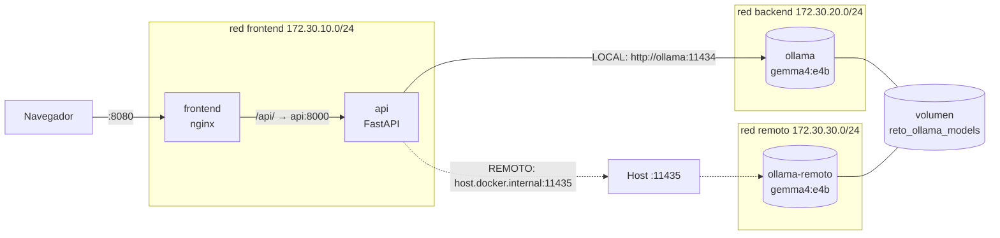

# Reto Docker · Chat con Gemma 4 (backend Ollama local o remoto)

Stack contenerizado con tres servicios principales:

| Servicio   | Qué hace | Imagen base | Puerto en tu PC |
|------------|----------|-------------|-----------------|
| `ollama`   | Sirve el modelo **Gemma 4 E4B** (`gemma4:e4b`) dentro del stack | `ollama/ollama` | — (no se publica) |
| `api`      | API Python (FastAPI) que habla con Ollama, **local o remoto** según `BACKEND_URL` | `python:3.12-slim` | `8000` |
| `frontend` | Web mínima de chat + proxy nginx hacia la API (DAW/DAM la sustituye) | `nginx:stable-alpine` | `8080` |
| `ollama-remoto` | Ollama "remoto simulado", aislado del stack (sustituye a Azure por ahora) | `ollama/ollama` | `11435` |
| `chat`     | El script de chat por terminal del día anterior (misma imagen que `api`) | — | — |



- El frontend **no puede** ver a Ollama: solo comparte red con la API.
- En modo remoto, la API **no comparte ninguna red** con `ollama-remoto`: le llega saliendo por el host, exactamente igual que llegaría a otro PC o a una VM de Azure.

---

## Estructura

```
reto-docker-ollama/
├── docker-compose.yml        # stack completo (redes, volúmenes, perfiles)
├── docker-compose.gpu.yml    # override opcional para GPU NVIDIA
├── .env                      # modo LOCAL (por defecto)
├── .env.remoto               # modo REMOTO (simulado, otro PC o Azure)
├── api/
│   ├── Dockerfile            # contenedoriza la API y el script de chat
│   ├── app.py                # API FastAPI
│   ├── chat.py               # script de chat por terminal (día anterior)
│   └── requirements.txt
├── ollama/
│   ├── Dockerfile            # Ollama + precarga de gemma4:e4b
│   └── entrypoint.sh         # arranca el servidor y descarga el modelo si falta
├── frontend/                 # frontend de prueba (DAW/DAM lo reemplaza)
├── optimizaciones/           # caché, parámetros y cuantización, activables con --env-file
├── pruebas-carga/            # script de estrés (asyncio + aiohttp) e informe con gráficas
├── scripts/verificar.sh|.ps1 # comprobación de extremo a extremo
└── docs/conceptos-docker.md  # explicación de imágenes, contenedores, volúmenes y redes
```

> **Pruebas de carga y optimización:** ver [`pruebas-carga/README.md`](pruebas-carga/README.md).

---

## 1. Requisitos

- **Docker Desktop** actualizado (incluye Docker Compose v2.20 o superior, necesario para `depends_on.required`).
- **RAM**: `gemma4:e4b` necesita unos 10 GB libres. Recomendado 16 GB en el equipo y **12 GB asignados a Docker**:
  - Windows (WSL2): crea `%UserProfile%\.wslconfig` con
    ```ini
    [wsl2]
    memory=12GB
    ```
    y ejecuta `wsl --shutdown` antes de reabrir Docker Desktop.
  - macOS: Docker Desktop → *Settings → Resources → Memory*.
  - ¿Menos RAM? Usa `MODEL_NAME=gemma4:e2b` en `.env` y en `.env.remoto`.
- **Disco**: unos 15 GB libres (la descarga del modelo pesa ~9,6 GB).
- Gemma 4 requiere Ollama ≥ 0.20; la imagen `ollama/ollama:latest` ya lo cumple.

### Verificar la instalación de Docker

```bash
docker --version
docker compose version
docker run hello-world
```

Si `hello-world` imprime *"Hello from Docker!"*, la instalación funciona (Docker descargó una imagen, creó un contenedor y lo ejecutó).

---

## 2. Despliegue en modo LOCAL

```bash
git clone <URL_DEL_REPO>
cd reto-docker-ollama
docker compose up -d --build
```

La **primera vez** el contenedor `ollama` descarga el modelo (~9,6 GB) y `docker compose up` espera a que esté listo antes de arrancar la API. Para ver el progreso, en otra terminal:

```bash
docker compose logs -f ollama
```

Cuando termine:

- Chat web: <http://localhost:8080> (etiqueta **Ollama local**)
- Documentación interactiva de la API (Swagger): <http://localhost:8000/docs>
- Estado del backend: <http://localhost:8000/health/backend>

Los siguientes arranques son inmediatos: el modelo queda guardado en el volumen `reto_ollama_models`.

### Verificación

```bash
./scripts/verificar.sh                                              # Linux / macOS / WSL / Git Bash
powershell -ExecutionPolicy Bypass -File .\scripts\verificar.ps1    # Windows
```

O a mano:

```bash
docker compose ps                                   # servicios en estado "healthy"
docker compose exec ollama ollama list              # gemma4:e4b aparece en la lista
curl http://localhost:8000/api/info                 # "modo": "local"
curl -X POST http://localhost:8000/api/chat \
     -H "Content-Type: application/json" \
     -d '{"messages":[{"role":"user","content":"Hola, ¿quién eres?"}]}'
```

(En PowerShell usa `curl.exe` en lugar de `curl`, o directamente el script `verificar.ps1`.)

### Chat por terminal (script del día anterior)

```bash
docker compose run --rm chat
```

Comandos dentro del chat: `/reset` borra el historial, `/salir` termina.

---

## 3. Despliegue en modo REMOTO

Mientras no tengamos acceso a Azure, el modo remoto se prueba con el servicio **`ollama-remoto`**: un segundo Ollama en su propia red, sin conexión directa con la API. La API llega a él por el puerto publicado en el host (`host.docker.internal:11435`), así que el camino de red es el mismo que hacia una máquina externa. Usa el mismo volumen, por lo que **no vuelve a descargar el modelo**.

### 3.1 Cambiar a remoto (remoto simulado)

```bash
docker compose stop ollama                              # libera la RAM del Ollama local
docker compose --env-file .env.remoto up -d --build
```

`.env.remoto` activa el perfil `remoto-simulado` (arranca `ollama-remoto` en lugar de `ollama`) y pone `BACKEND_URL=http://host.docker.internal:11435`. Compose detecta que la configuración de `api` ha cambiado y la recrea.

Comprueba:

```bash
curl http://localhost:8000/api/info       # "modo": "remoto", "backend_url": "http://host.docker.internal:11435"
./scripts/verificar.sh
```

La web pasa a mostrar la etiqueta **Ollama remoto**.

Prueba de que la API **no** ve al remoto por la red interna, solo por el host:

```bash
docker compose exec api python -c "import socket; socket.gethostbyname('ollama-remoto')"          # falla
docker compose exec api python -c "import urllib.request; print(urllib.request.urlopen('http://host.docker.internal:11435').read())"
# b'Ollama is running'
```

### 3.2 Volver a local

```bash
docker compose stop ollama-remoto
docker compose up -d
```

### 3.3 Cambiar de backend solo con la variable de entorno

La variable de la shell tiene prioridad sobre el fichero `.env`, así que también se puede cambiar el backend al vuelo, sin tocar ficheros:

```bash
# Linux / macOS / Git Bash
BACKEND_URL=http://<IP_DEL_BACKEND>:11435 docker compose up -d api
```

```powershell
# Windows PowerShell
$env:BACKEND_URL="http://<IP_DEL_BACKEND>:11435"; docker compose up -d api
Remove-Item Env:BACKEND_URL; docker compose up -d api      # volver a local
```

### 3.4 Remoto real: el Ollama de un compañero

Una buena prueba en clase con dos equipos de la misma red:

1. **Equipo servidor** (compañero): `docker compose --env-file .env.remoto up -d ollama-remoto` y averigua su IP (`ipconfig` / `ip a`). Si usa Windows, puede que tenga que permitir el puerto 11435 en el firewall.
2. **Equipo cliente** (tú): en `.env.remoto`, deja `COMPOSE_PROFILES=` vacío y pon `BACKEND_URL=http://<IP_DEL_COMPAÑERO>:11435`. Después: `docker compose --env-file .env.remoto up -d`.
3. Desde el cliente: `curl http://<IP_DEL_COMPAÑERO>:11435/api/tags` debe listar `gemma4:e4b`.

Ollama no tiene autenticación: no lo dejéis publicado fuera de la red de clase.

### 3.5 Pendiente: VM de Azure

Cuando haya acceso, solo cambia la configuración, no el código ni las imágenes. En `.env.remoto`:

```ini
COMPOSE_PROFILES=
BACKEND_URL=http://<IP_PUBLICA_VM>:11434
```

Requisitos en la VM: Ollama escuchando en `0.0.0.0:11434` (`Environment="OLLAMA_HOST=0.0.0.0:11434"` en el servicio systemd), `ollama pull gemma4:e4b`, y el puerto 11434 abierto en el NSG **solo para vuestra IP pública**. Alternativa más segura: túnel SSH (`ssh -N -L 11436:localhost:11434 azureuser@<IP_VM>`) y `BACKEND_URL=http://host.docker.internal:11436`.

---

## 4. Variables de entorno

| Variable | Por defecto | Para qué sirve |
|---|---|---|
| `COMPOSE_PROFILES` | `local` | `local` arranca `ollama`; `remoto-simulado` arranca `ollama-remoto`; vacío = backend externo |
| `BACKEND_URL` | `http://ollama:11434` | Dónde está Ollama |
| `BACKEND_API_KEY` | vacío | Token Bearer si el backend está detrás de un proxy con autenticación |
| `MODEL_NAME` | `gemma4:e4b` | Modelo que descarga Ollama y que pide la API |
| `PRELOAD_IN_IMAGE` | `false` | `true` mete el modelo dentro de la imagen en el build |
| `OLLAMA_KEEP_ALIVE` | `30m` | Tiempo que el modelo sigue cargado en RAM |
| `REMOTO_PORT` | `11435` | Puerto del host donde se publica `ollama-remoto` |
| `API_PORT` / `WEB_PORT` | `8000` / `8080` | Puertos publicados en tu PC |
| `REQUEST_TIMEOUT` | `300` | Segundos máximos de espera por respuesta |
| `CACHE_ENABLED` / `CACHE_TTL` / `CACHE_MAX_ITEMS` | `false` / `600` / `500` | Caché de respuestas en la API (`optimizaciones/1-cache.env`) |
| `MODEL_NUM_PREDICT` / `MODEL_TEMPERATURE` / `MODEL_NUM_CTX` / `MODEL_THINK` | vacío | Parámetros por defecto del modelo que aplica la API (`optimizaciones/2-parametros.env`) |
| `OLLAMA_NUM_PARALLEL` / `OLLAMA_MAX_QUEUE` / `OLLAMA_CONTEXT_LENGTH` / `OLLAMA_FLASH_ATTENTION` / `OLLAMA_KV_CACHE_TYPE` | vacío (valores de Ollama) | Rendimiento del servidor Ollama (`optimizaciones/2-parametros.env`) |

Las optimizaciones se suman a la configuración base pasando varios `--env-file` (el último gana):

```bash
docker compose --env-file .env --env-file optimizaciones/1-cache.env --env-file optimizaciones/2-parametros.env up -d
```

Orden de prioridad (de más a menos): variable de la shell → fichero `.env` (o el de `--env-file`) → valor por defecto en `docker-compose.yml`.

---

## 5. Redes y volúmenes

**Redes** (definidas en `docker-compose.yml`):

| Red | Subred | Quién está | Para qué |
|---|---|---|---|
| `reto_frontend` | 172.30.10.0/24 | `frontend`, `api` | Entrada desde el navegador |
| `reto_backend` | 172.30.20.0/24 | `api`, `ollama`, `chat` | Acceso al Ollama local |
| `reto_remoto` | 172.30.30.0/24 | `ollama-remoto` | Aislado; solo accesible por el puerto del host |

- Dentro de cada red, los contenedores se encuentran **por nombre de servicio** gracias al DNS interno de Docker (`127.0.0.11`). Por eso `BACKEND_URL=http://ollama:11434` funciona.
- `ollama` no publica puertos: desde fuera del stack no se puede llegar a él.

Prueba del aislamiento (modo local):

```bash
docker compose exec frontend wget -qO- -T 3 http://ollama:11434   # falla: "bad address 'ollama'"
docker compose exec api python -c "import urllib.request; print(urllib.request.urlopen('http://ollama:11434').read())"
# b'Ollama is running'
```

**Volumen** `reto_ollama_models` montado en `/root/.ollama` (lo comparten `ollama` y `ollama-remoto`):

```bash
docker volume inspect reto_ollama_models
docker compose down        # borra contenedores y redes, el modelo se conserva
docker compose down -v     # borra TAMBIÉN el volumen: la próxima vez se vuelve a descargar
```

---

## 6. GPU NVIDIA (opcional)

```bash
docker compose -f docker-compose.yml -f docker-compose.gpu.yml up -d --build
docker compose exec ollama ollama ps        # la columna PROCESSOR debe indicar GPU
```

---

## 7. Comandos útiles

```bash
docker compose ps                         # estado y salud de los servicios
docker compose logs -f api                # logs en directo de la API
docker compose exec ollama ollama list    # modelos descargados
docker compose exec ollama ollama ps      # modelos cargados en memoria
docker network inspect reto_backend       # IPs de los contenedores en la red
docker compose config                     # compose final con las variables ya sustituidas
docker compose down                       # parar y borrar contenedores (el volumen se conserva)
```

---

## 8. Problemas frecuentes

| Síntoma | Causa probable | Solución |
|---|---|---|
| `docker compose up` se queda en *Waiting* mucho rato | Primera descarga del modelo | `docker compose logs -f ollama` para ver el progreso |
| `Pool overlaps with other one on this address space` | Las subredes 172.30.x chocan con otra red | Cambia las `subnet` en `docker-compose.yml` |
| `Bind for 0.0.0.0:8000 failed: port is already allocated` | Puerto ocupado | Cambia `API_PORT`, `WEB_PORT` o `REMOTO_PORT` |
| `exec /usr/local/bin/entrypoint.sh: no such file or directory` | Finales de línea CRLF (Windows) | `.gitattributes` y el Dockerfile ya lo corrigen; vuelve a clonar y `--build` |
| `model requires more system memory` | Poca RAM para Docker, o los dos Ollama cargados a la vez | Para el que no uses (`docker compose stop ollama`), sube la RAM o usa `gemma4:e2b` |
| 502 *No se puede conectar con el backend* en modo remoto | `ollama-remoto` parado, puerto 11435 bloqueado o IP errónea | `curl http://localhost:11435/api/tags` (o la IP del compañero) |
| `BACKEND_URL=http://localhost:11434` no funciona | Dentro de un contenedor, `localhost` es el propio contenedor | Usa `ollama` (local) o `host.docker.internal` (tu PC) |
| La primera respuesta tarda mucho | El modelo se carga en RAM la primera vez | Normal; las siguientes son más rápidas |

---

## 9. Para DAW/DAM: añadir vuestro frontend

El servicio `frontend` es un marcador de posición. Para sustituirlo:

1. Poned vuestro proyecto en `frontend/` (o cambiad `build:` a vuestra carpeta).
2. Mantened el servicio en la red `frontend`: así llega a la API como `http://api:8000`.
3. Si el frontend se sirve desde el navegador, la opción más simple es el proxy `/api/` de `frontend/nginx.conf` (mismo origen, sin CORS). Si no, la API acepta CORS (`CORS_ORIGINS`).
4. Endpoints disponibles (ver <http://localhost:8000/docs>):
   - `GET /api/info` → `{ backend_url, modo, modelo, parametros, cache, backend }`
   - `POST /api/chat` → body `{ "messages": [{ "role": "user", "content": "..." }] }` → `{ reply, modelo, modo, cache, metricas }`
     - con `"stream": true` responde NDJSON en el formato de Ollama (lo usa el script de carga)
     - opcionales: `"options": {"num_predict": 256}`, `"think": false`
   - `POST /api/chat/stream` → mismo body, respuesta en texto plano trozo a trozo
   - `DELETE /api/cache` → vacía la caché
   - `GET /health`, `GET /health/backend`

Para una app móvil en el emulador de Android, la API está en `http://10.0.2.2:8000`.
